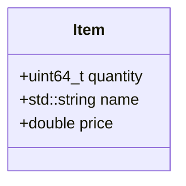

# C++ C-Structs Exercises

Compile your code via

```shell
mkdir build -p && cd build
cmake ..
make -j8  # use 8 processor cores when compiling
```

If needed, consult the test files
([complex_numbers_test.cpp](complex_numbers_test.cpp),
 [student_database_test.cpp](student_database_test.cpp) and
 [grand_total_test.cpp](grand_total_test.cpp))
to understand what exactly your code needs to accomplish.


## Task 1 - Complex Numbers
In `complex_numbers.hpp` implement a struct `Complex` that stores the `real`
number and the imaginary unit (`imag`). Both `real`
and `image` should be `double`.
Implement the following functions in `complex_numbers.cpp`:

```cpp
Complex add(Complex a, Complex b);  // return the sum of `a` and `b`
Complex sub(Complex a, Complex b);  // return the difference of `a` and `b`
Complex mul(Complex a, Complex b);  // return the product of `a` and `b`
```

Having these functions in place, it becomes possible to add, substract,
and multiply two complex numbers. The mathematical basis for the
implementation is available on Wikipedia for
[addition and substraction](https://en.wikipedia.org/wiki/Complex_number#Addition_and_subtraction)
as well as
[multiplication](https://en.wikipedia.org/wiki/Complex_number#Multiplication_and_square).

Name the source file `complex_numbers.cpp` and the header file
`complex_numbers.hpp`.


## Task 2 - Student Data
In `student_database.hpp` implement a struct that stores information about a
student in a struct
called `Student`. Each student has a
`uint64_t id`,
`std::string first_name`  and a
`std::string last_name` (in that order). Don't forget to also declare all used
functions in the header file.

Implement the following functions:

```cpp
Student read_student(std::istream& in);  // read student info from stream
// print one student per line to out
void print_students(std::ostream& out, std::vector<Student> students);
```

Name the source file `student_database.cpp` and the header file
`student_database.hpp`.


# Task 3 - Calculate Grand Total
You're given a vector of products with their quantity, name and unit
price. It is your duty to calculate the grand total (for each product,
multiply the quantity and its unit price and then calculate the sum of these
products).
To do so, implement the function
`double calculate_grand_total(std::vector<Item> items)`.

The `struct Item` has to be declared in a header file so that it can be
re-used in other files as well. It must follow the specification in the
diagram below



Name the source file `grand_total.cpp` and the header file `shopping.hpp`.
